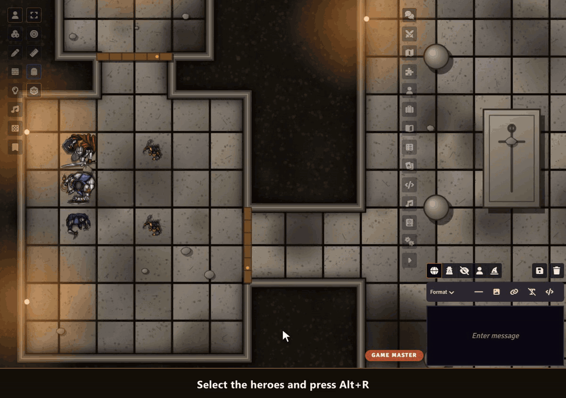

# Sephral’s Roll Requests

**“Everyone, a Wisdom save.” Then the chat fills with rolls, someone rolls a Wisdom check instead, and you count by hand who made it. Roll Requests asks the whole group in two clicks, players roll with one, and a single card shows who passed.**

## Highlights

* **Ask anyone:** the selected tokens, all player characters or any actor you drag into the window. Alt+R opens it.
* **The right roll every time:** saving throws, ability checks, skills and tools as your game system names them, or your own formula. Start it with advantage or disadvantage if you like.
* **One click for players:** a small window and the chat card show a roll button for each of their characters. The roll is the system's own, with its dialog, bonuses and dice.
* **One live card:** totals, pass or fail against the DC and “3 of 4 passed” at a glance, filled in while your players roll. Natural 20s and 1s stand out.
* **Secret when you want it:** hide the DC, keep the results for your eyes only, or let nobody see their own roll.
* **Group checks:** the group succeeds when at least half succeed, worked out for you.
* **NPCs roll themselves:** characters without a player roll at once, and one click rolls the rest for anyone who is away.
* **Rerolls count:** a hero point in Pathfinder 2e or a benny in Savage Worlds replaces the result on the card, and you can let anyone roll again.
* **Nothing gets lost:** rolls made while no GM is online reach their card as soon as a GM joins, and a player who logs in late still gets the roll window.
* **Many systems:** D&D 5e, Pathfinder 2e, Savage Worlds and Crucible, formulas in any other system.

## How it works

1. Select tokens and press Alt+R, or click the d20 in the token controls.
2. Pick the roll, set a DC if you like, and send the request.
3. Watch the card fill up while your players roll.

## Good to know

Players need to be online to roll, the GM can roll for anyone from the card. A GM has to be connected for results to reach the card, rolls made without one are added when a GM joins.

## Install

Use the manifest URL `https://github.com/Sephral/sephrals-roll-requests/releases/latest/download/module.json` in Foundry's module installer.

Foundry VTT 13 and 14 · any game system · English and German

## Learn more

The request window, the visibility choices, the settings and the API for macros are explained in the [manual](MANUAL.md). Questions or ideas? Join us on [Discord](https://discord.gg/7BjCgDYaBP). Looking for more? See [all modules by Sephral](https://github.com/Sephral).

The token pictures in the demo are icons from [game-icons.net](https://game-icons.net) (CC BY 3.0) that come with Foundry VTT, shown on colored discs.

## License

See [LICENSE.md](LICENSE.md).
